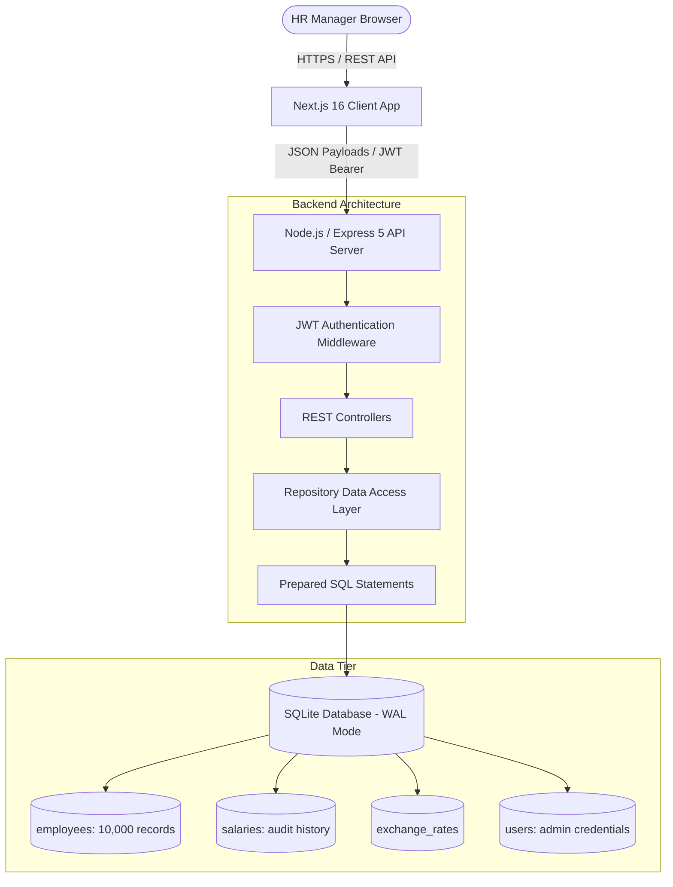
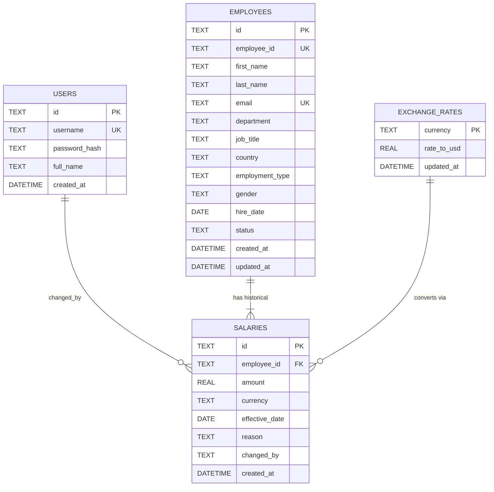

# Architecture & Technical Design Document

## 1. System Architecture Overview

The ACME Employee Salary Management System is designed as a decoupled, multi-tier web application optimized for ultra-fast queries over 10,000+ employee records.



---

## 2. Layered Architecture

1. **Presentation Layer (Frontend):**
   - **Framework:** Next.js 16 (React 19, TypeScript).
   - **Design System:** Tailwind CSS with custom glassmorphism and modern dark theme.
   - **Data Visualization:** Recharts for departmental analytics, salary distribution histograms, and equity graphs.
   - **Authentication State:** React Context (`AuthContext`) for JWT session persistence and route protection.
   - **Server State:** **TanStack Query v5 (React Query)** — all API data lives in typed custom hooks (`src/hooks/useAnalytics.ts`). A singleton `QueryClient` (`src/lib/queryClient.ts`) provides a 2-minute `staleTime` cache, automatic request deduplication, background refetch, and a single `refetch()` API.
   - **Hook Layer (`src/hooks/`):** Encapsulates query keys, parallel `Promise.all` fetching, and `useMemo`-derived chart data. Pages contain zero `useEffect` data-fetching logic.

2. **API & Business Logic Layer (Backend):**
   - **Framework:** Express 5 on Node.js.
   - **Security:** `helmet` for HTTP security headers, strict CORS configuration, `bcryptjs` (salt rounds: 12) for credential hashing, JWT verification with token invalidation.
   - **Repository Pattern:** Isolates SQL queries and transaction management from HTTP routing logic (`employeeRepo`, `analyticsRepo`, `authRepo`).

3. **Persistence Layer (Database):**
   - **Database:** SQLite via synchronous, high-throughput `better-sqlite3`.
   - **Mode:** Write-Ahead Logging (`PRAGMA journal_mode = WAL`) and `PRAGMA synchronous = NORMAL` for concurrent read performance.
   - **Prepared Statements:** 100% of queries use parameterized prepared statements preventing SQL injection and benefiting from query plan caching.

---

## 3. Database Schema & Data Model



### Key Schema Design Decisions:
- **Append-Only Salary Ledger (`salaries` table):**
  Instead of overwriting `employees.current_salary`, every salary modification creates a new entry with `effective_date`, `reason`, and `changed_by`. The current salary is resolved dynamically via a subquery or window function:
  ```sql
  SELECT s.amount, s.currency, s.effective_date 
  FROM salaries s 
  WHERE s.employee_id = e.id 
  ORDER BY s.effective_date DESC, s.created_at DESC 
  LIMIT 1
  ```
  This guarantees a complete, tamper-evident audit history of all employee raises and title transitions.

- **Indexing Strategy for 10,000+ Records:**
  - `idx_employees_dept`: Optimizes department filtering and aggregation.
  - `idx_employees_country`: Accelerates country-level analytics.
  - `idx_employees_type`: Accelerates employment type filtering.
  - `idx_employees_search`: Composite index on `(first_name, last_name, employee_id)` for sub-millisecond search.
  - `idx_salaries_emp_date`: Composite index on `(employee_id, effective_date)` for fast current salary lookup.

---

## 4. API Specification & Endpoints

| Category | Method | Endpoint | Description |
| :--- | :--- | :--- | :--- |
| **Auth** | `POST` | `/api/auth/login` | Authenticate HR manager, returns JWT token |
| | `POST` | `/api/auth/logout` | Invalidate session |
| | `GET` | `/api/auth/me` | Fetch active authenticated user profile |
| **Employees** | `GET` | `/api/employees` | Paginated, filtered, and sorted employee directory |
| | `GET` | `/api/employees/meta` | Distinct departments, countries, currencies, types |
| | `GET` | `/api/employees/:id` | Full profile with comprehensive salary history |
| | `POST` | `/api/employees` | Onboard new employee with starting salary |
| | `PUT` | `/api/employees/:id` | Update employee biographical details |
| | `DELETE` | `/api/employees/:id` | Soft-deactivate employee record |
| | `POST` | `/api/employees/:id/salary` | Record new salary increment with reason |
| **Analytics** | `GET` | `/api/analytics/summary` | Global payroll, headcounts, average salary in requested currency |
| | `GET` | `/api/analytics/by-department` | Departmental headcount & total compensation breakdown |
| | `GET` | `/api/analytics/by-country` | Geographic headcount and payroll distribution |
| | `GET` | `/api/analytics/distribution` | Statistical salary distribution buckets/histogram |
| | `GET` | `/api/analytics/top-earners` | Highest compensated employees globally or by department |
| **Export** | `GET` | `/api/export/csv` | Stream filtered dataset directly to CSV file |
